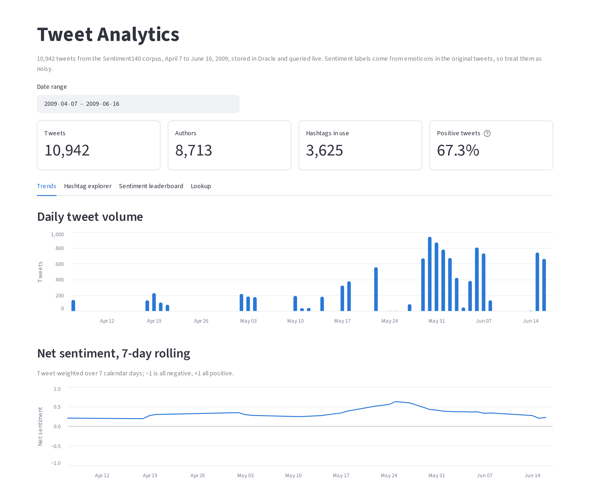
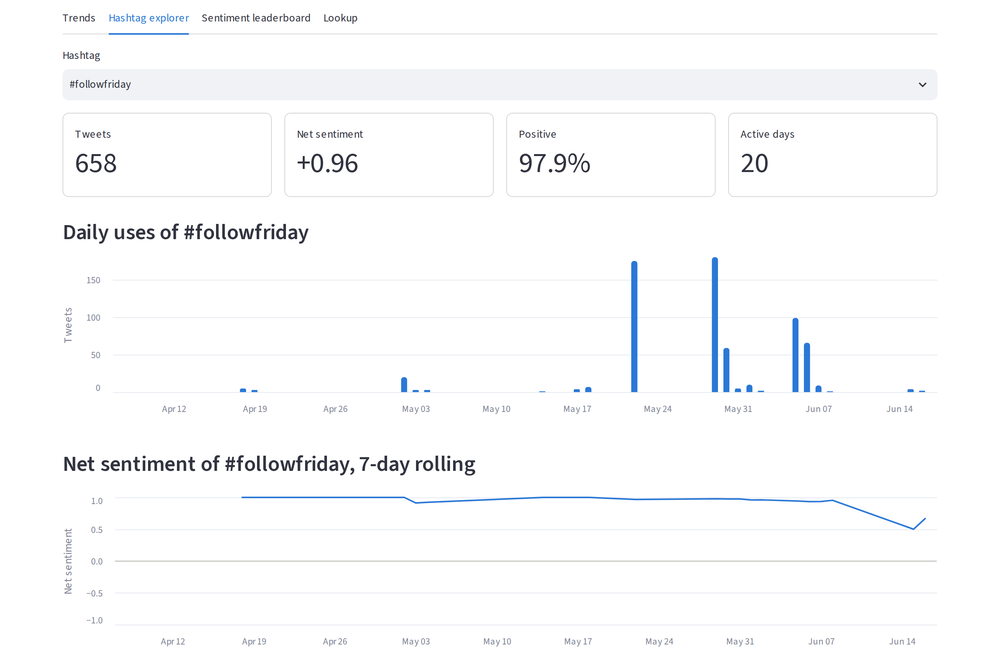
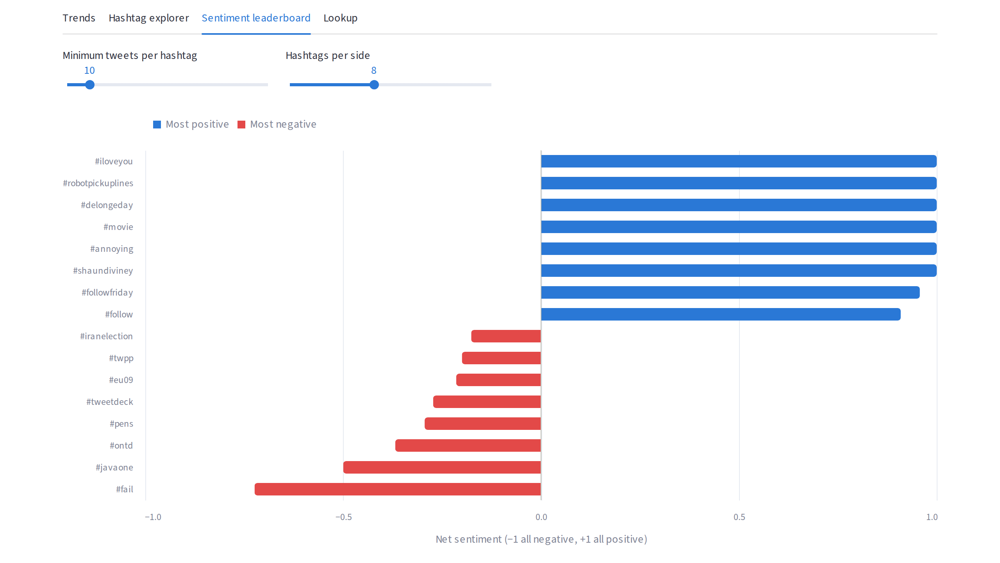
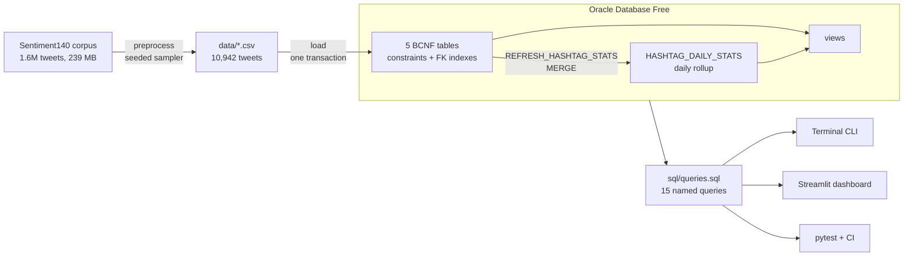
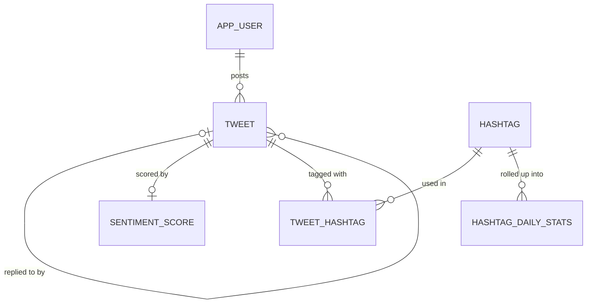

# Tweet Analytics DB

**An Oracle database that turns raw tweets into hashtag trends and sentiment
analytics.** A Python ETL pipeline samples the 1.6-million-tweet Sentiment140
corpus into a normalized schema. PL/SQL keeps daily rollups current, and the
data is explored through a terminal app and a Streamlit dashboard. Everything
runs locally with Docker and is tested in CI against a real Oracle database.

[](https://github.com/connor-p-mccune/tweet-analytics-db/actions/workflows/ci.yml)


[](LICENSE)

<picture>
  <source media="(prefers-color-scheme: dark)" srcset="docs/img/dashboard-trends-dark.png">
  
</picture>

## Highlights

- **Data engineering.** A deterministic, two-pass sampler streams the full
  239 MB corpus and handles several data-quality problems in the source
  (see [Data pipeline](#data-pipeline)). One of them, labels collected over
  different date ranges, would otherwise have produced a nine-day
  "collapse in sentiment" that never happened.
- **Relational design.** A five-table schema in BCNF, with named constraints,
  a case-insensitive unique index, and an index on every foreign key.
  Integration tests check the execution plans.
- **PL/SQL and analytical SQL.**
  - an idempotent `MERGE` refresh procedure
  - window functions: `ROW_NUMBER`, `LAG`, and `RANGE`-based rolling averages
  - CTEs
  - rollups that store only additive measures, so ratios stay exact at any
    grain
- **One copy of the SQL.** 15 named queries live in a single
  [`queries.sql`](sql/queries.sql) file, used by the CLI, the dashboard, the
  docs, and the tests.
- **Tested end to end.** 68 unit tests plus 38 integration tests run against
  Oracle Database Free in GitHub Actions, including a headless run of the
  dashboard.
- **Reproducible.** `docker compose up`, then three commands. The
  python-oracledb thin driver needs no Oracle client install.

## What the data shows

Each feature is one named query. These results come straight from the sample
data.

**Trending hashtags, week of June 1, 2009** (Feature 9: week-over-week growth
using `LAG()`). E3 2009 takes over the week. Further down the list, `#xboxe3`
grew 1,350% and `#eu09` (the European Parliament election) grew 1,150%.

```text
tag_text     week_start  uses  prev_week_uses  change  growth_pct
-----------  ----------  ----  --------------  ------  ----------
e3           2009-06-01    66               0      66
fb           2009-06-01   132              78      54          69
musicmonday  2009-06-01    46               0      46
```

<table>
  <tr>
    <td width="50%"></td>
    <td width="50%"></td>
  </tr>
  <tr>
    <td><b>Hashtag explorer.</b> #followfriday spikes every Friday and is 97.9% positive.</td>
    <td><b>Sentiment leaderboard.</b> The most positive and most negative hashtags for any date range.</td>
  </tr>
</table>

All nine features, with example output for each, are documented in
[docs/features.md](docs/features.md).

## Architecture





The full ER diagram, functional-dependency analysis, and the reasoning behind
each constraint and index are in
[docs/database-design.md](docs/database-design.md).

## Quickstart

Requires Docker and Python 3.11+.

```bash
git clone https://github.com/connor-p-mccune/tweet-analytics-db.git
cd tweet-analytics-db
cp .env.example .env

docker compose up -d                  # Oracle Database Free; wait for "healthy" in `docker compose ps`

python -m venv .venv
source .venv/bin/activate             # Windows: .venv\Scripts\activate
pip install -r requirements.txt

python -m social_analytics init-db    # tables, indexes, procedure, views
python -m social_analytics load       # load data/*.csv and build rollups (a few seconds)

streamlit run dashboard/app.py        # dashboard at http://localhost:8501
python -m social_analytics cli        # or the terminal menu
```

To use an existing Oracle database (12.1 or later) instead of Docker, point
`DB_USER`, `DB_PASSWORD`, and `DB_DSN` in `.env` at it.

## Data pipeline

The sample in `data/` is produced by `python -m social_analytics preprocess`
from the raw corpus. That output is committed so the project runs without the
81 MB download. To rebuild it:

```bash
mkdir -p raw
curl -L -o raw/trainingandtestdata.zip https://cs.stanford.edu/people/alecmgo/trainingandtestdata.zip
python -m social_analytics preprocess   # about 1.5 minutes, byte-identical output on every run
```

Profiling the full corpus turned up problems that each shaped a design
decision:

| Finding in the source | Consequence if ignored | Handling |
|---|---|---|
| Rows are sorted by label (800k negative, then 800k positive) | A "first N rows" sample is 100% negative. The original class version of this project did exactly that. | Sample across the whole file; keep/drop decisions hash `(seed, tweet_id)` |
| 1,685 tweet ids appear twice with opposite labels | Contradictory ground truth | Dropped |
| Positive tweets stop at 15:40 UTC on June 16; negative tweets continue to June 25 | A fake collapse to 100% negative over the last nine days | Keep only the period that both labels cover, computed from the data |
| Rows mix UTF-8 and cp1252, and about 1,100 hold unrecoverable double-encoded text | Mojibake such as `�` in tweets | Decode each line with a fallback; drop rows that are mostly non-ASCII |
| Text is HTML-escaped (`&#39;`, `&amp;`) | `&#39;` would be extracted as the hashtag `#39` | Unescape first, then extract hashtags using Twitter's rules |
| Timestamps are in US Pacific time | Days would split at the wrong boundary | Converted to UTC |

The sampler oversamples tweets with hashtags (about 2% of the corpus) so that
trends have real volume. It also adds the complete timelines of 100 users so
that per-user lookups return histories.

## Testing

```bash
pip install -r requirements-dev.txt
pytest                    # 68 unit tests; no database needed
pytest -m integration     # 38 tests; drops and rebuilds the schema in the database in .env
ruff check . && ruff format --check .
```

**Unit tests** cover:
- every ETL rule, plus a byte-identical end-to-end run on a miniature archive
- the SQL script splitter and the query catalog parser
- CLI input handling and output formatting
- a consistency check confirming that the committed CSVs satisfy every key

**Integration tests** check:
- row counts after the load
- rollup totals and refresh idempotency
- that constraints reject bad rows
- every catalog query
- the username lookup's execution plan
- a headless run of the dashboard using Streamlit's `AppTest`

[CI](.github/workflows/ci.yml) runs lint and both suites on every push and
pull request, with Oracle Database Free as a service container.

## Project structure

```text
├── sql/
│   ├── 01_schema.sql          tables, constraints, indexes, data dictionary
│   ├── 02_analytics.sql       rollup table, MERGE refresh procedure, views
│   ├── queries.sql            the 15 named queries (single source of truth)
│   └── load_sqlcl.sql         alternative loader for SQLcl users
├── social_analytics/
│   ├── etl/preprocess.py      Sentiment140 → data/*.csv
│   ├── etl/load.py            data/*.csv → Oracle, in one transaction
│   ├── sql_runner.py          runs the sql/ scripts (init-db)
│   ├── queries.py             loads queries.sql by name
│   ├── db.py, config.py       connections and settings (thin mode)
│   └── cli.py                 terminal menu for all nine features
├── dashboard/app.py           Streamlit dashboard
├── data/                      committed sample (2.9 MB)
├── docs/                      design notes, feature reference, screenshots
├── tests/                     unit tests, plus integration/ against Oracle
├── docker-compose.yml         Oracle Database Free
└── .github/workflows/ci.yml
```

## Roadmap

- Score tweets with a second model (for example VADER or a transformer) by
  keying `SENTIMENT_SCORE` on `(tweet_id, model_version)`, and compare it with
  the emoticon labels.
- Schedule incremental rollup refreshes with `DBMS_SCHEDULER`.
- Partition `TWEET` by month to scale beyond the sample.
- Host a read-only demo of the dashboard.

## Background and team

This project began as a team project for COP 3701, covering requirements, ER
modeling, normalization, an Oracle implementation, and a query application.
It was later extended into the end-to-end pipeline described here.

- **Connor McCune** (database owner): schema design and normalization, ETL and
  data pipeline, analytics layer, dashboard, tests, and CI
- **Johnathan Nguyen**: the original query features (1–5) and the terminal
  application

**Data:** Sentiment140, from Go, A., Bhayani, R., and Huang, L. (2009),
*Twitter Sentiment Classification using Distant Supervision*, Stanford
University. Labels were assigned automatically from emoticons, so they are
noisy. The tweets are unfiltered public posts from 2009.

## License

[MIT](LICENSE)
