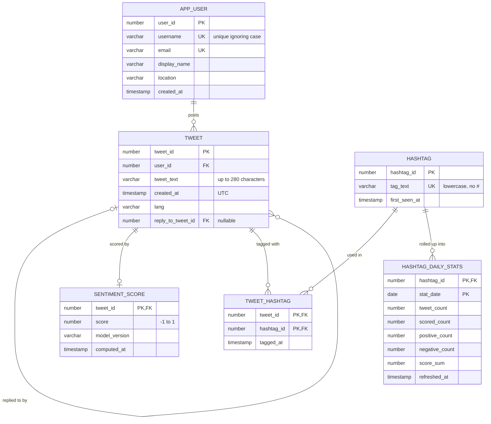

# Database design

This document covers the data model behind the project: the entity-relationship
design, the normalization analysis, and the reasoning behind each constraint,
index, and analytics object. The DDL lives in [`sql/01_schema.sql`](../sql/01_schema.sql)
and [`sql/02_analytics.sql`](../sql/02_analytics.sql).

## Who the database serves

| User group | What they need |
|---|---|
| Analysts / data scientists | Sentiment over time, hashtag usage, ad-hoc SQL over clean tables |
| Marketing / brand teams | Trending and most positive/negative hashtags for a period |
| System administrators | Reproducible loads, enforced integrity, predictable query plans |

## Entity-relationship model

**Design notes**

- **Tweets ↔ hashtags is many-to-many,** resolved by the associative entity
  `TWEET_HASHTAG`. Its composite primary key `(tweet_id, hashtag_id)` stops a
  tweet from being linked to the same hashtag twice.
- **Tweet ↔ sentiment is one-to-zero-or-one.** A tweet can exist before it has
  been scored, which is why the relationship is optional on the score side.
  Sentiment lives in its own table so that scoring can be re-run or replaced
  without touching tweets.
- **Replies are a self-reference** on `TWEET`. Sentiment140 carries no reply
  ids, so the column is empty in the sample data, but the model supports
  threads.
- **`APP_USER` rather than `USER`,** because `USER` is a reserved word in Oracle.
- **`HASHTAG_DAILY_STATS` is derived data,** covered under
  [Analytics layer](#analytics-layer) below.

## Relational schema and normalization (BCNF)

| Relation | Key | Other candidate keys |
|---|---|---|
| APP_USER(user_id, username, email, display_name, location, created_at) | user_id | email; username (case-insensitive) |
| TWEET(tweet_id, user_id, tweet_text, created_at, lang, reply_to_tweet_id) | tweet_id | — |
| HASHTAG(hashtag_id, tag_text, first_seen_at) | hashtag_id | tag_text |
| TWEET_HASHTAG(tweet_id, hashtag_id, tagged_at) | (tweet_id, hashtag_id) | — |
| SENTIMENT_SCORE(tweet_id, score, model_version, computed_at) | tweet_id | — |
| HASHTAG_DAILY_STATS(hashtag_id, stat_date, …) | (hashtag_id, stat_date) | — |

**Functional dependencies**

- APP_USER: user_id → username, email, display_name, location, created_at;
  email → user_id; LOWER(username) → user_id
- TWEET: tweet_id → user_id, tweet_text, created_at, lang, reply_to_tweet_id
- HASHTAG: hashtag_id → tag_text, first_seen_at; tag_text → hashtag_id
- TWEET_HASHTAG: (tweet_id, hashtag_id) → tagged_at
- SENTIMENT_SCORE: tweet_id → score, model_version, computed_at
- HASHTAG_DAILY_STATS: (hashtag_id, stat_date) → every count and sum

Every non-trivial dependency's determinant is a candidate key, so every
relation is in **Boyce-Codd normal form** and no decomposition is needed. User
attributes live only in `APP_USER`, and hashtag text lives only in `HASHTAG`,
so no fact is stored twice among the base tables.

## Integrity rules

| Constraint | Rule | Why |
|---|---|---|
| `uq_app_user_username_ci` | unique `LOWER(username)` | Twitter handles are unique regardless of case; the same function-based index serves case-insensitive lookups |
| `uq_app_user_email`, `uq_hashtag_tag_text` | unique | Candidate keys from the FD analysis |
| `ck_hashtag_lowercase` | `tag_text = LOWER(tag_text)` | Guarantees one row per hashtag; matches how the ETL normalizes tags |
| `ck_sentiment_score_range` | `score BETWEEN -1 AND 1` | Keeps every model on one scale |
| `ck_tweet_not_self_reply` | `reply_to_tweet_id <> tweet_id` | A tweet cannot reply to itself |
| `fk_sentiment_tweet`, `fk_th_tweet` | `ON DELETE CASCADE` | A deleted tweet takes its score and hashtag links with it |
| `fk_tweet_reply` | `ON DELETE SET NULL` | Deleting a tweet leaves its replies in place |
| `fk_tweet_user`, `fk_th_hashtag` | no cascade | Deleting a user or hashtag that is still referenced is refused, so a mistake cannot remove many rows at once |
| `ck_hds_counts`, `ck_hds_whole_day` | counts add up; dates are midnight | Keeps the rollup internally consistent |

Text columns use `CHAR` length semantics (`VARCHAR2(280 CHAR)`), so a tweet
with multi-byte characters is measured in characters, not bytes.

## Indexes

Oracle indexes primary keys and unique constraints automatically, but **not
foreign keys**. An unindexed foreign key means full scans when joining from the
parent side, and a table lock on the child whenever a parent row is deleted.

| Index | Columns | Serves |
|---|---|---|
| `uq_app_user_username_ci` | `LOWER(username)` | Feature 1 lookup (unique scan) and the case-insensitive uniqueness rule |
| `ix_tweet_user_created` | `TWEET(user_id, created_at)` | A user's timeline in one range scan; the FK to `APP_USER` |
| `ix_tweet_created_at` | `TWEET(created_at)` | Date-range filters and daily rollups |
| `ix_tweet_reply_to` | `TWEET(reply_to_tweet_id)` | `ON DELETE SET NULL` without a full scan |
| `ix_tweet_hashtag_tag` | `TWEET_HASHTAG(hashtag_id, tweet_id)` | Hashtag → tweets joins, index-only |
| `ix_hds_stat_date` | `HASHTAG_DAILY_STATS(stat_date, hashtag_id)` | Daily leaderboards and weekly trend windows |

The integration tests check the execution plan of the username lookup to make
sure the function-based and composite indexes are actually used.

## Analytics layer

**`HASHTAG_DAILY_STATS`** holds one row per hashtag per UTC day. It repeats
facts that can be computed from the base tables, so it is controlled
redundancy: it can be rebuilt at any time, and it lets trend queries read a
few thousand rollup rows instead of joining every tweet. It stores only
**additive** measures (counts and score sums). Averages and percentages are
computed at query time, so they stay exact when days are rolled up into weeks
or longer windows. Averaging stored daily averages would weight a 1-tweet day
the same as a 200-tweet day.

**`REFRESH_HASHTAG_STATS(p_from, p_to)`** rebuilds any date window, or
everything when both arguments are null, using one `MERGE` statement:

- inserts days that are missing
- updates only rows whose values changed, so re-running it touches nothing
  (verified by a test)
- deletes days that no longer have tweets

It does not commit; the caller owns the transaction. The loader calls it
inside the load transaction, so committed data and rollups always match.

**Views**

- `v_daily_activity` gives volume and net sentiment per day, plus a 7-day
  rolling value. The window is `RANGE BETWEEN 6 PRECEDING AND CURRENT ROW`
  over dates. `ROWS` would be wrong here because the corpus has multi-day
  gaps, and the previous 6 rows can span weeks. The rolling value is
  tweet-weighted.
- `v_hashtag_sentiment` gives lifetime usage, net sentiment, percent
  positive, and active days per hashtag.

## Data semantics

- **Timestamps are UTC.** The source records US Pacific time; the ETL converts
  it.
- **`APP_USER.created_at`** is the time of the user's earliest tweet in the
  sample. Sentiment140 has no account creation dates.
- **Emails are synthetic** (`<handle>@example.com`), because the source has
  none. They exist only to keep the original schema's unique email column
  meaningful.
- **`score`** is −1 (negative) or +1 (positive) for Sentiment140 labels, which
  were assigned from emoticons in the original tweets. **Net sentiment** is
  the mean score, so +0.5 means 75% positive.

These notes are also stored in the database as `COMMENT ON` metadata, visible
in `USER_TAB_COMMENTS` and `USER_COL_COMMENTS`.
